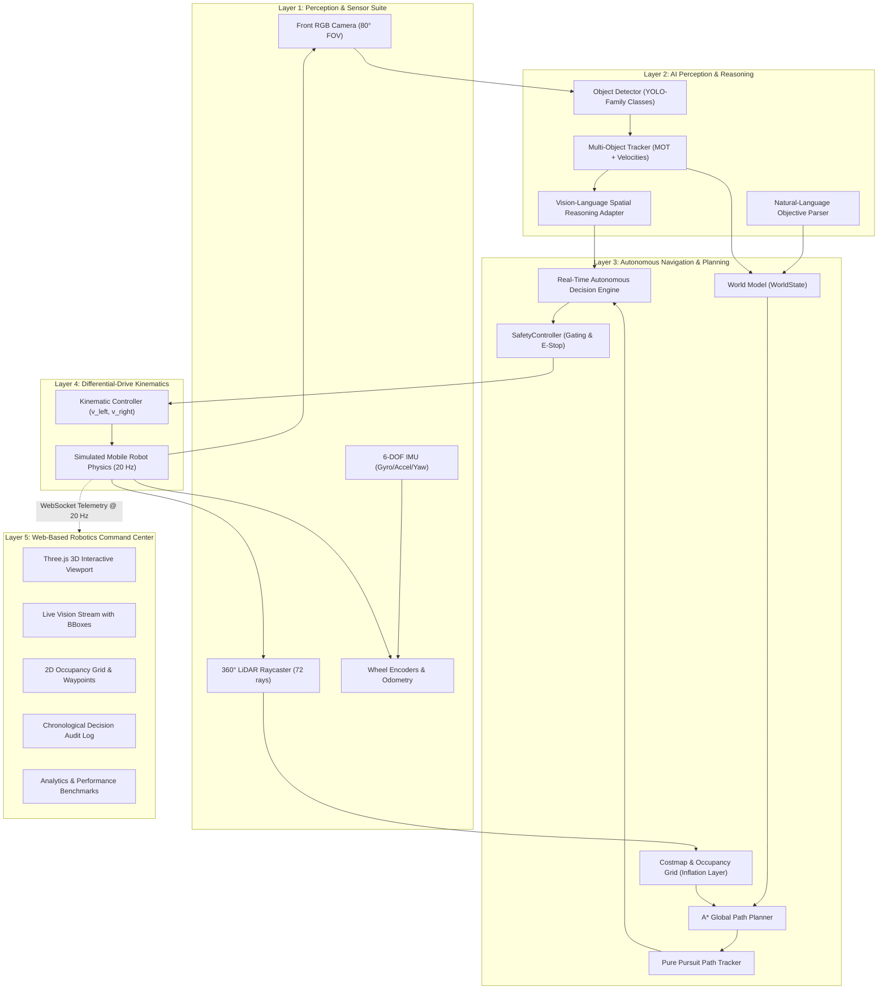

# VisionNav AI — Vision-Based Autonomous Robot

[](#)
[](#)
[](#)
[](#)
[](#)
[](#)

> **Tagline:** *"See. Understand. Navigate."*  
> **Status:** Functional Prototype — Hackathon Challenge Submission

---

## 🚀 Overview

**VisionNav AI** is an autonomous mobile robot simulation and perception command center. It demonstrates how AI computer vision, spatial reasoning, and robotics autonomy integrate to understand environments, detect objects and people, avoid dynamic obstacles, and navigate autonomously toward high-level natural language objectives.

Built across two distinct, integrated layers:
1. **Layer 1: Robotics Simulation & Autonomy Core (Python / FastAPI / ROS 2)**  
   Features realistic differential-drive kinematics, 360° LiDAR raycasting, front camera projection, A* global path planning on an inflated costmap, dynamic obstacle avoidance, an independent safety supervisor (`SafetyController`), and a real-time `DecisionEngine`.
2. **Layer 2: Web-Based Robotics Command Center (React, TypeScript, Three.js, Tailwind CSS)**  
   Visualizes the live simulation state with an interactive 3D WebGL facility viewport, synthetic camera feed with YOLO bounding boxes, 2D occupancy costmap, live world model register, and analytics.

> [!IMPORTANT]
> **SIMULATION MODE NOTICE:** All sensor streams, camera projections, and kinematics are simulated. The dashboard visualizes genuine simulation states rather than claiming real-world physical actuation.

---

## 🏗️ System Architecture



## 🌟 Key Features

- **End-to-End Robotics Pipeline**:
  `Camera/Sensors` $\rightarrow$ `Perception` $\rightarrow$ `Object Detection` $\rightarrow$ `Tracking` $\rightarrow$ `Scene Understanding` $\rightarrow$ `Target Interpretation` $\rightarrow$ `World Model` $\rightarrow$ `A* Path Planning` $\rightarrow$ `Safety Check` $\rightarrow$ `Motor Command` $\rightarrow$ `Robot Movement` $\rightarrow$ `Replan`
- **Differential-Drive Kinematics**:
  $$v_{\text{left}} = v - \frac{\omega \cdot L}{2}, \quad v_{\text{right}} = v + \frac{\omega \cdot L}{2}$$
  Configurable acceleration ramps, max velocities ($0.8\text{ m/s}$ linear, $1.2\text{ rad/s}$ angular), braking thresholds, and battery discharge dynamics.
- **AI Vision & Object Detection**:
  Projects 3D entities into camera coordinates with normalized bounding boxes, confidence ratings ($80\%-99\%$), distances in meters, and tracking IDs (`P-01`, `B-01`, `O-04`). Detects `person`, `chair`, `table`, `box`, `bottle`, `laptop`, and `target`.
- **Multi-Object Tracking (MOT)**:
  Estimates Euclidean velocity vectors $\mathbf{v} = (\Delta x / \Delta t, \Delta y / \Delta t)$ across frames, classifying entities as `Static`, `Active`, or `Moving`.
- **Vision-Language Model (VLM) Adapter**:
  Modular `VisionLanguageModel` interface supporting natural language prompt interpretation (`interpret_objective`) and scene analysis (`analyze_scene`). Includes a deterministic local spatial reasoning fallback that runs 100% offline with zero external API dependencies.
- **Independent Safety Controller**:
  **AI never directly controls actuators.** Every command is evaluated by `SafetyController`. Intervenes with emergency brakes if obstacles breach the $0.45\text{ m}$ critical threshold or throttles speed inside the $1.20\text{ m}$ warning perimeter.
- **Dynamic Obstacle Avoidance & Replanning**:
  Continuously monitors the path corridor. When a dynamic humanoid enters the trajectory, the robot slows down, updates the local costmap, triggers `REPLANNING`, computes an A* detour, and safely resumes.
- **3 Realistic Facilities**:
  Switch between **Industrial Warehouse**, **Modern Office**, and **Smart Laboratory**.
- **Judge Demo Mode**:
  Single-click **"START DEMO"** runs the complete Warehouse blue package retrieval scenario with dynamic pedestrian detour.

---

## 📋 Quick Start Guide

### 1. Prerequisites
- **Python 3.10+** (Tested on Python 3.11)
- **Node.js 18+** and **npm**

### 2. Run Automated Pytest Tests & Perception Verification
```bash
# Verify the entire navigation, simulation, perception, and safety suite:
.\.venv\Scripts\pytest -v

# Or run the end-to-end camera-to-detection verification script:
.\.venv\Scripts\python scripts/verify_perception_pipeline.py
```
*(All 56 automated tests pass in ~1.5 seconds).*

### 3. Launch Backend Simulation Server
```bash
.\.venv\Scripts\python.exe -m uvicorn backend.app.main:app --host 0.0.0.0 --port 8000
```
- REST API: `http://localhost:8000/api`
- Interactive Swagger Docs: `http://localhost:8000/docs`
- WebSocket Telemetry: `ws://localhost:8000/ws/robot` (20 Hz)

### 4. Launch Frontend Command Center
In another terminal:
```bash
cd frontend
npm run dev
```
Open **`http://localhost:5173`** in your browser.

---

## 🤖 Judge Demo Mode Instructions

1. Open `http://localhost:5173`.
2. Click the glowing **"JUDGE DEMO"** button in the top bar or sidebar.
3. Observe the full autonomous sequence:
   - **Mission Dispatched:** *"Find the blue package and navigate to it."*
   - **Target Identified:** Blue shipping package located at $(16.5, 5.5)$.
   - **Global Route Planned:** 14 A* waypoints generated.
   - **Robot Begins Movement:** Differential drive accelerates along corridor.
   - **Dynamic Obstacle Encounter:** Technician Alex steps into the route.
   - **Safety Intervention:** Robot slows down to safe velocity ($0.15\text{ m/s}$).
   - **Dynamic Replan:** A* calculates an alternative collision-free detour around the racks.
   - **Target Reached:** Robot arrives within $0.45\text{ m}$ of the package.
   - **Success Audit:** Decision log logs every stage with timestamps and confidence scores.

---

## 📂 Project Structure

```
visionnav-ai/
  ├── README.md               # Master Project Documentation
  ├── LICENSE                 # MIT License
  ├── .gitignore              # Git Ignore Rules
  ├── .env.example            # Environment Configurations Template
  ├── docker-compose.yml      # Multi-container orchestration
  │
  ├── docs/
  │   ├── architecture.md     # In-depth system architecture & math
  │   ├── demo.md             # Judge demonstration scenario walkthrough
  │   ├── api.md              # REST & WebSocket specifications
  │   ├── setup.md            # Step-by-step installation instructions
  │   └── judging.md          # Evaluation criteria & rubric mapping
  │
  ├── backend/
  │   ├── Dockerfile          # Backend container definition
  │   ├── requirements.txt    # Python dependencies
  │   └── app/
  │       ├── main.py         # FastAPI entrypoint & 20Hz loop
  │       ├── core/config.py  # Robot kinematics & sensor parameters
  │       ├── models/         # Pydantic data models (robot, perception, nav, world)
  │       ├── perception/     # Detector, multi-object tracker, VLM adapter
  │       ├── navigation/     # Occupancy grid, A* planner, pure pursuit navigator
  │       ├── safety/         # SafetyController gating all actuator commands
  │       ├── decision/       # Real-time DecisionEngine audit trail
  │       ├── simulation/     # Robot physics, LiDAR raycasting, environments
  │       ├── services/       # MissionManager & analytics calculations
  │       └── websocket/      # Telemetry broadcaster manager
  │
  ├── frontend/
  │   ├── package.json        # Node dependencies (Three.js, Lucide, Tailwind)
  │   ├── src/
  │   │   ├── components/     # TopBar, Sidebar, RightPanel, SimulationViewport3D
  │   │   ├── pages/          # LiveVision, NavigationMap, WorldModel, Sensors, etc.
  │   │   ├── services/       # REST and WebSocket client
  │   │   ├── types/          # TypeScript robotics definitions
  │   │   └── App.tsx         # Master Command Center coordination
  │
  ├── robotics/
  │   └── ros2_ws/src/visionnav_robot/  # ROS 2 package (URDF, Nav2 config, nodes)
  │
  ├── simulation/
  │   ├── environments/       # Exported warehouse, office, and lab environment maps
  │   ├── scenarios/          # Predefined JSON evaluation scenarios
  │   └── assets/             # Simulation 3D assets & sensor specification
  │
  ├── scripts/
  │   └── verify_perception_pipeline.py # End-to-end perception test
  │
  ├── models/
  │   └── README.md           # AI vision & detector documentation
  │
  └── tests/                  # 56 Pytest unit & integration test suites
```

---

## 📊 Analytics & Benchmarks

VisionNav AI automatically tracks and computes key operational metrics:
- **Path Efficiency**: $\frac{\text{shortest feasible distance}}{\text{actual traversed path}} \times 100\%$
- **Navigation Success Rate**: $\frac{\text{successful mission arrivals}}{\text{total missions}} \times 100\%$
- **Perception Stability**: $\frac{\text{consistent detections}}{\text{total detection frames}} \times 100\%$
- **Dynamic Replan Latency**: $< 50\text{ ms}$ on $0.20\text{ m}$ grid

---

## ⚖️ License

Distributed under the MIT License. See [LICENSE](LICENSE) for more information.
