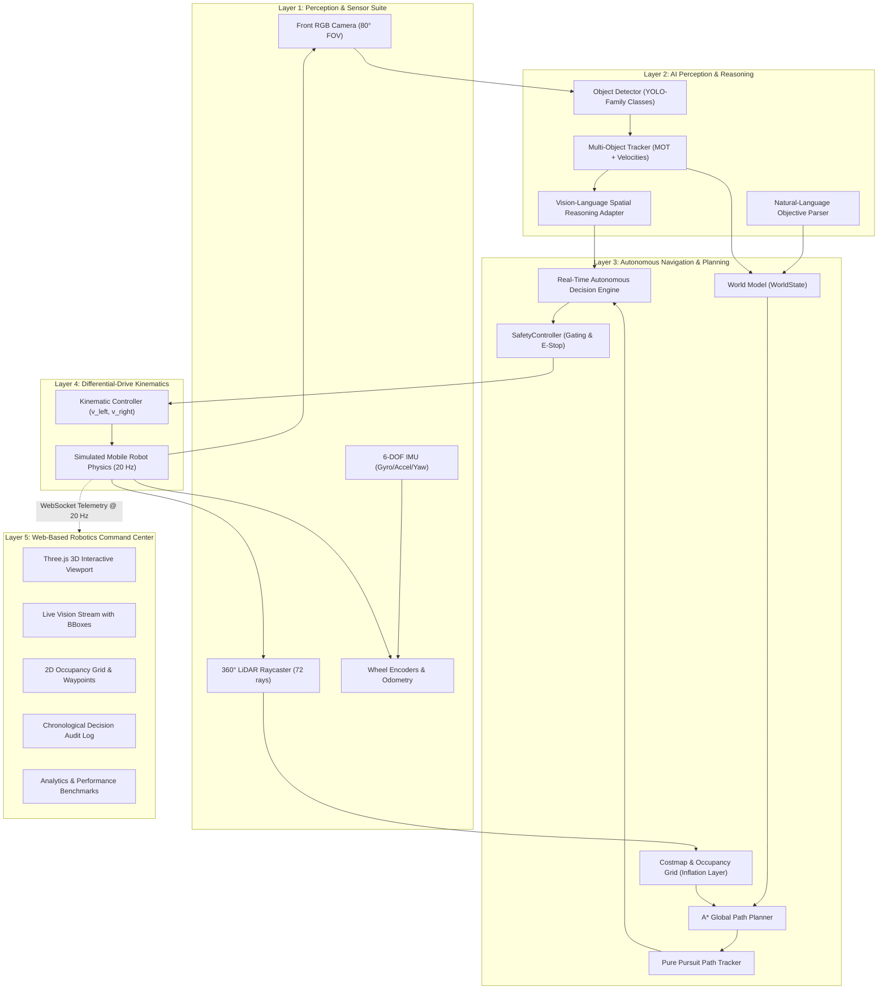
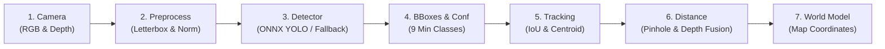

# VisionNav AI — System Architecture & Technical Specification

> **Tagline:** "See. Understand. Navigate."  
> **Simulation Classification:** Professional Autonomous Robotics Simulation ("SIMULATION MODE")

---

## 1. Executive Architecture Overview

VisionNav AI is engineered following a layered robotics paradigm:

---

## 2. Core Subsystems

### 2.1 Differential-Drive Kinematics

The mobile robot chassis utilizes differential steering governed by standard nonholonomic unicycle kinematics:

$$v_{\text{left}} = v - \frac{\omega \cdot L}{2}$$
$$v_{\text{right}} = v + \frac{\omega \cdot L}{2}$$

Where:
- $v$: Desired forward linear velocity ($\le 0.8\text{ m/s}$)
- $\omega$: Desired rotational angular velocity ($\le 1.2\text{ rad/s}$)
- $L$: Wheel base width ($0.45\text{ m}$)
- $R$: Wheel radius ($0.10\text{ m}$)

Odometry integration per simulation step $\Delta t$:
$$\Delta x = v \cos(\theta) \Delta t$$
$$\Delta y = v \sin(\theta) \Delta t$$
$$\Delta \theta = \omega \Delta t$$

---

### 2.2 Costmap & A* Global Path Planning

The occupancy grid discretizes the environment into $0.20\text{ m}$ cells.
- **Static Obstacle Layer**: Walls, storage racks, lab benches, conference tables.
- **Inflation Buffer Layer**: Expands obstacles by the robot radius ($0.35\text{ m}$) to prevent corner collisions.
- **Dynamic Obstacle Layer**: Dynamically rasterizes moving humanoids and temporary hazards.
- **A\* Heuristic**: Octile distance accounting for diagonal 8-connectivity.
- **Greedy Line-of-Sight Shortcutter**: Eliminates stair-stepping grid artifacts to generate smooth straight paths.

---

### 2.3 Independent Safety Controller

The AI model or high-level planner **never commands motors directly**. All requested velocities pass through the `SafetyController`:
1. **Emergency Stop Interlock**: If E-Stop is active, velocity is immediately zeroed ($0.0\text{ m/s}$).
2. **Critical Proximity Brake**: If the nearest obstacle is closer than $0.45\text{ m}$, forward linear drive is locked to $0.0\text{ m/s}$.
3. **Warning Proximity Throttle**: If an obstacle is between $0.45\text{ m}$ and $1.20\text{ m}$, linear speed is dynamically scaled down.
4. **Kinematic Limits Clamp**: Prevents excessive linear or angular accelerations.

---

### 2.4 End-to-End 7-Stage AI Perception Pipeline

The vision subsystem implements a modular, high-throughput perception stack executing at 20 FPS:

1. **Stage 1: Camera Acquisition:** Captures synchronized RGB frames ($320 \times 240$ uint8) and solid-state depth buffers ($80$ range bins, $80^\circ$ FOV).
2. **Stage 2: Frame Preprocessing:** Letterboxes frame to $(640, 640)$, pads borders preserving aspect ratio, converts uint8 to float32 $[0.0, 1.0]$, and maintains unpadding metadata for coordinate inversion.
3. **Stage 3 & 4: Object Detector & Bounding Boxes:** Evaluates minimum supported classes: `person`, `chair`, `table`, `box`, `backpack`, `bottle`, `laptop`, `door`, `obstacle`.
   - *Preferred Model:* ONNX Runtime YOLOv8 neural network inference.
   - *Deterministic Local Fallback:* Clearly labeled `LOCAL_FALLBACK_GEOMETRIC_PROJECTOR` with `is_fallback: True` and `model_source: 'fallback_geometric'`. Fallback outputs are never misrepresented as neural inference.
4. **Stage 5: Multi-Object Tracking (MOT):** Tracks objects across consecutive frames using combined IoU and centroid association with EMA smoothing and velocity estimation ($\mathbf{v} = (\Delta x / \Delta t, \Delta y / \Delta t)$).
5. **Stage 6: Metric Distance Estimation:** Computes optical distance using pinhole geometry ($Z = \frac{f \cdot H_{\text{real}}}{h_{\text{pixels}}}$) fused with forward depth scan buffer readings.
6. **Stage 7: 3D World Model Integration:** Projects chassis-relative 3D positions $(x_{\text{robot}}, y_{\text{robot}}, z)$ into global map coordinates using robot heading yaw $\theta$ and updates spatial entity records.

---

### 2.5 Modular Vision-Language Model (VLM) Adapter

- `analyze_scene(detections, robot_state, target, ...)` $\rightarrow$ Returns structured JSON containing scene descriptions, navigation constraints, risk assessments, and recommended autonomous behaviors.
- `interpret_objective(prompt)` $\rightarrow$ Converts natural language commands into target coordinates and semantic categories.
- Deterministic local spatial reasoning engine operates fully offline with zero external cloud API dependencies. Optional connectors support Gemini 1.5/2.0 and GPT-4o.

