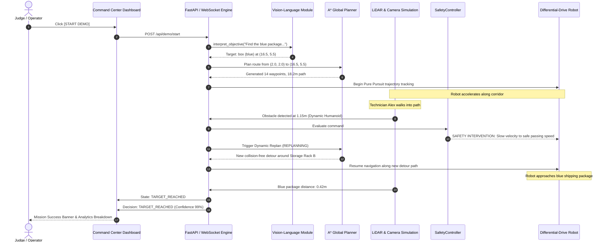

# VisionNav AI — Judge Demo Scenario & Demonstration Guide

## Scenario: Industrial Warehouse Blue Package Retrieval

### Objective
> **Mission Prompt:** `"Find the blue package and navigate to it."`

The autonomous mobile robot starts near the warehouse entrance. A blue shipping package is positioned in the fulfillment zone across the facility. Along the central corridor, a warehouse technician (simulated humanoid Alex) patrols across the primary trajectory.

---

## Autonomous Execution Sequence

---

## Live Demonstration Verification Checklist

1. **Top Bar Status:**
   - Notice the prominent **"SIMULATION MODE"** badge.
   - Live **"20 Hz LIVE"** WebSocket connection status.
   - Emergency Stop button toggles immediate motor inhibition.

2. **Judge Demo Mode Pipeline Indicator:**
   - Shows progressive stages:
     `PERCEPTION` $\rightarrow$ `TARGET IDENTIFIED` $\rightarrow$ `PLANNING` $\rightarrow$ `NAVIGATING` $\rightarrow$ `OBSTACLE DETECTED` $\rightarrow$ `REPLANNING` $\rightarrow$ `TARGET REACHED`.

3. **3D Interactive Simulation Viewport:**
   - Left-click drag to rotate camera in 3D orbit around the facility.
   - Toggle to **"Top-Down 2D"** or **"Chase Cam"** mode.
   - Observe cyan LiDAR laser rays scanning the environment and dynamic red hit points.
   - Observe planned path ribbon update in real-time when the technician enters the route.

4. **Live Vision Feed:**
   - Switch to **"Live Vision"** tab to view the front camera perspective.
   - Notice YOLO-style bounding boxes with confidence %, distance, and tracking ID.
   - Notice the blue package tagged with the glowing **"TARGET"** badge.

5. **Decision Log Audit Trail:**
   - Chronological timestamps, actions (`REPLAN`, `SLOW_DOWN`, `FOLLOW_PATH`, `TARGET_REACHED`), and confidence ratings.
